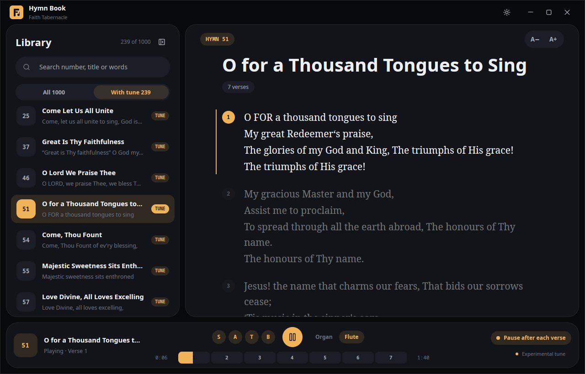

<div align="center">


# Hymn Book

**Faith Tabernacle Hymn Book for the desktop. Read every hymn, and hear its tune.**

Windows · macOS · Linux — free and open source

**[Website and downloads](https://hymnbook-two.vercel.app)** · [Latest release](../../releases/latest) · [Suggest or report something](../../issues/new/choose)



</div>

Many of us know the words of our hymns but have forgotten how they are sung.
Hymn Book puts all **1,000 hymns** in one clean app and plays the tune of the
hymns it has music for, the way it is sung: **verse, chorus, verse, chorus…**

## Features

- **Search** by number, title, or any line you remember.
- **Hear the tune** on a church organ or a flute. Tunes are marked *experimental*.
- **Song map**: a bar of verse and chorus segments. Tap any segment to jump there.
- **Pause after each verse** to sing at your own pace, then press play for the next.
- **Voice parts**: switch Soprano, Alto, Tenor and Bass on or off to learn your line.
- **Lyrics follow the song**: the verse being sung is highlighted and scrolled into view.
- Light and dark themes, adjustable lyric size, works offline.

> **Tunes today:** 239 of the 1,000 hymns have a tune. They are public-domain
> arrangements matched to each hymn's words, so they may differ from your church's
> own arrangement. Help us grow the library – see [Contributing](CONTRIBUTING.md).

## Download

Get the installer for your system from the [**latest release**](../../releases/latest)
or from the [website](https://hymnbook-two.vercel.app):

| System | File | How |
|--------|------|-----|
| **Windows** | `HymnBook-Setup-windows-x86_64.exe` | Run the installer. (`HymnBook-windows-x86_64.exe` is a portable single file.) If SmartScreen warns, choose *More info → Run anyway*. |
| **macOS** (Apple Silicon / Intel) | `HymnBook-macos-arm64.dmg` / `HymnBook-macos-x86_64.dmg` | Open the disk image and drag **Hymn Book** to Applications. The first time, right-click → *Open* (the app is not notarised). |
| **Linux** | `HymnBook-linux-x86_64.AppImage` | `chmod +x` it and run it – nothing to install. |
| **Debian / Ubuntu** | `HymnBook-linux-amd64.deb` | Double-click it, or `sudo apt install ./HymnBook-linux-amd64.deb`. |

## Build from source

You need [Rust](https://rustup.rs) (1.85+).

```bash
git clone <this repository>
cd <repository>
cargo run --release
```

On Linux install the system libraries first:

```bash
sudo apt-get install libasound2-dev libxkbcommon-dev libxkbcommon-x11-dev \
  libwayland-dev libx11-xcb-dev libxcb1-dev libfontconfig-dev libfreetype-dev \
  libvulkan-dev pkg-config
```

Run the tests with `cargo test`. Releases are built by GitHub Actions
(`.github/workflows/release.yml`) when a version tag such as `v0.1.0` is pushed.

## How it works

The app is written in Rust with [GPUI](https://www.gpui.rs).

```
src/main.rs      window, bundled fonts
src/app.rs       state and behaviour (no drawing)
src/ui/          one file per screen region: library, reader, player, splash…
src/audio/       synthesizer, MIDI reading, verse/chorus arrangement
src/hymn.rs      hymn data: lyric parsing and search
src/tunes/       the bundled tunes (generated table)
tools/           icon + tune conversion and matching scripts
site/            the download website (static, deploy to Vercel)
```

**Tunes.** Each tune is a four-voice MIDI file converted from a public-domain ABC
score by `tools/abc2mid.py`. A score holds one pass of the music, so the player
*arranges* it into the full song: it finds where the chorus starts (from the score's
lyric layout), then repeats verse and chorus for as many verses as the hymn has,
joined on exact sample boundaries so nothing clicks or drops out. Sound comes from a
General MIDI SoundFont played by [`rustysynth`](https://github.com/sinshu/rustysynth).

**Matching.** `tools/match_freehymns.py` matches hymns to scores by comparing their
full lyrics (word trigrams), which works even when titles differ.

## Contributing

Ideas, bug reports and tunes are welcome – open an issue or a pull request. See
[CONTRIBUTING.md](CONTRIBUTING.md). The most useful help is **checking tunes by ear**
and sharing public-domain scores for the hymns that still have none.

## License and credits

Code: [MIT](LICENSE). Bundled tunes, fonts, the SoundFont and the hymn texts keep
their own terms – see [THIRD_PARTY.md](THIRD_PARTY.md). Tunes come from the
[Open Hymnal Project](https://github.com/mzealey/openhymnal) and
[freehymns](https://github.com/freehymns/hymns) (from *The Cyber Hymnal*).

Not affiliated with any church body.
